# Laporan Praktikum 5: JavaScript Dasar dan Manipulasi HTML

**Mata Kuliah:** Pemrograman Web  
**Dosen Pengampu:** Agung Nugroho, M.Kom  

---

## Identitas Mahasiswa

| Informasi | Keterangan |
| :--- | :--- |
| **Nama Lengkap** | Kartika Juliana Sasongko |
| **NIM** | 312310267 |
| **Kelas** | TI.25.1D |
| **Program Studi** | Teknik Informatika |
| **Email** | kartikajuliana05@gmail.com |
| **Perguruan Tinggi** | Universitas Pelita Bangsa, Bekasi |

---

## Tujuan Praktikum

Berdasarkan Modul Praktikum 5 Pemrograman Web, tujuan praktikum ini adalah:
1. Memahami sintaks dasar JavaScript dan cara menyisipkan JavaScript pada dokumen HTML.
2. Menggunakan variabel, tipe data, operator, percabangan (`if-else` & `switch`), perulangan (`for`), dan fungsi (`function`).
3. Menampilkan informasi melalui berbagai saluran output: `console.log()`, `alert()`, `prompt()`, serta manipulasi konten elemen HTML (`textContent` dan `innerHTML`).
4. Memanipulasi konten serta gaya visual elemen HTML (CSS DOM manipulation) menggunakan JavaScript.
5. Membuat interaksi interaktif pada formulir web (*form*) dan melakukan validasi input pengguna.
6. Mendokumentasikan pekerjaan praktikum secara sistematis beserta bukti pengujian yang nyata dan dapat dipertanggungjawabkan.

---

## Struktur File Repository

```text
Lab5Web/
├── index.html                     # Halaman utama (Latihan 1-8, Eksperimen Mandiri, Tugas 7)
├── script.js                      # Kode logika JavaScript eksternal untuk index.html
├── kalkulator.html                # Mini Project: Kalkulator Nilai Mahasiswa
├── kalkulator.js                  # Logika perhitungan, validasi, dan kontrol UI kalkulator
├── style.css                      # Tata letak dan gaya visual antarmuka web
├── Laporan_Praktikum5_312310267.pdf # Dokumen Laporan Lengkap Praktikum 5
├── screenshots/                   # Berkas tangkapan layar asli dari peramban (1280x820)
│   ├── 01_latihan1_output.png
│   ├── 03_latihan3_operasi.png
│   ├── 06a_latihan6_genap.png
│   ├── 06b_latihan6_ganjil.png
│   ├── 06c_latihan6_tidak_valid.png
│   ├── 07a_latihan7_hijau.png
│   ├── 07b_latihan7_kuning.png
│   ├── 08a_latihan8_kosong.png
│   ├── 08b_latihan8_dipilih.png
│   ├── 09a_eksperimen_tabel7.png
│   ├── 09b_eksperimen_cekgenap.png
│   ├── 09c_eksperimen_validasi_kosong.png
│   ├── 09d_eksperimen_toggle_sembunyi.png
│   ├── 10a_tugas7_gagal.png
│   ├── 10b_tugas7_berhasil.png
│   ├── 11a_kalkulator_validasi.png
│   ├── 11b_kalkulator_skenario1.png
│   ├── 11c_kalkulator_skenario2.png
│   └── 11d_kalkulator_skenario3.png
└── README.md                      # Dokumentasi komprehensif praktikum
```

---

## Cara Menjalankan Halaman Web

1. **Unduh atau Kloning Repository:**
   ```bash
   git clone https://github.com/kartika573/Lab5Web.git
   cd Lab5Web
   ```
2. **Membuka Halaman Utama:**
   - Buka berkas `index.html` langsung di peramban web modern (Google Chrome, Microsoft Edge, atau Mozilla Firefox) dengan klik ganda atau menggunakan skema URL lokal `file:///C:/Users/HP/Downloads/Lab5Web/index.html`.
   - Tidak memerlukan web server khusus (PHP/Node/Apache) karena seluruh aplikasi berbasis murni *Client-Side JavaScript*.
3. **Membuka Developer Tools (Console):**
   - Tekan tombol `F12` pada keyboard, atau kombinasi `Ctrl + Shift + I` (Windows), lalu klik pada tab **Console**.
   - Output dari instruksi `console.log()` akan langsung terlihat pada tab tersebut.
4. **Membuka Mini Project:**
   - Navigasi melalui tautan menu di header/footer `index.html` menuju `kalkulator.html`, atau buka langsung berkas `kalkulator.html` di peramban.

> **Catatan Desain Interaksi:**  
> Seluruh latihan yang melibatkan kotak dialog interaktif pengguna (`prompt()`) dijalankan melalui **klik tombol**, bukan secara otomatis ketika halaman pertama kali dimuat. Hal ini dilakukan demi kenyamanan pengguna agar tidak terjadi penumpukan *modal dialog* yang saling memblokir saat memuat dokumen.

---

## Hasil Latihan Praktikum

### Latihan 1: Menampilkan Output
- **Penjelasan:** Mengubah konten elemen paragraf ber-ID `pesan` dari teks semula (`"Konten awal."`) menjadi `"Hello World"` menggunakan properti DOM `textContent`. Pada saat bersamaan, mencetak pesan `"Hello World"` ke tab Console pengembang peramban melalui fungsi bawaan `console.log()`.
- **Perbedaan:** `textContent` langsung memodifikasi Document Object Model dan hasilnya tampak oleh seluruh pengunjung di badan halaman, sedangkan `console.log()` mencetak data diagnostik ke Developer Tools Console yang umumnya digunakan pemrogram untuk keperluan pengujian dan pelacakan *bug*.
- **Kode Program:**
  ```javascript
  document.getElementById("pesan").textContent = "Hello World";
  console.log("Hello World");
  ```
- **Tabel Hasil Pengujian:**
  | Objek Pengujian | Input | Hasil yang Diharapkan | Hasil Nyata di Browser | Status |
  | :--- | :--- | :--- | :--- | :--- |
  | Elemen `#pesan` | Inisialisasi berkas | Konten berubah menjadi "Hello World" | Konten: `"Hello World"` | **LULUS** |
  | Console Browser | Inisialisasi berkas | Mencetak teks "Hello World" | Pesan di Console: `"Hello World"` | **LULUS** |

- **Tangkapan Layar:**
  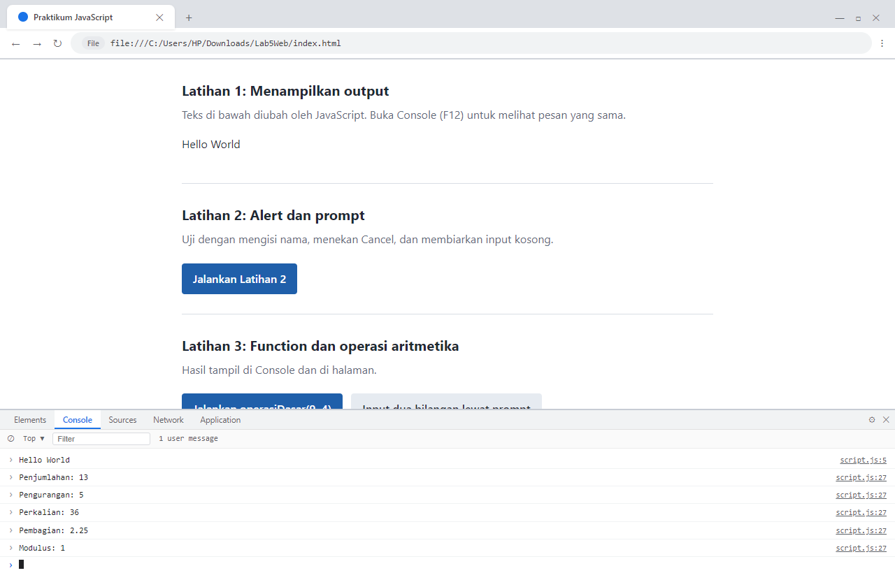

---

### Latihan 2: Alert dan Prompt
- **Penjelasan:** Meminta data nama pengguna secara dinamis melalui dialog interaktif `prompt()`. Data yang dimasukkan divalidasi: jika tidak bernilai `null` (pengguna tidak menekan Cancel) dan setelah dipangkas spasi (`.trim()`) tidak kosong, program menampilkan salam pembuka `alert("Halo, <nama>!")` serta memperbarui paragraf `#pesan`. Sebaliknya, jika kosong atau Cancel, program memberikan peringatan `alert("Nama belum diisi.")`.
- **Kode Program:**
  ```javascript
  function latihan2() {
    const namaPengguna = prompt("Masukkan nama Anda:", "");
    if (namaPengguna && namaPengguna.trim() !== "") {
      alert("Halo, " + namaPengguna + "!");
      document.getElementById("pesan").textContent = "Selamat datang, " + namaPengguna + ".";
    } else {
      alert("Nama belum diisi.");
    }
  }
  ```
- **Tabel Hasil Pengujian:**
  | Skenario | Aksi Pengguna | Nilai Kembalian `prompt` | Output Dialog `alert` | Konten Elemen `#pesan` | Status |
  | :--- | :--- | :--- | :--- | :--- | :--- |
  | **Isi Nama** | Ketik "Kartika" lalu klik OK | `"Kartika"` | `"Halo, Kartika!"` | `"Selamat datang, Kartika."` | **LULUS** |
  | **Batal/Cancel** | Klik tombol Batal/Cancel | `null` | `"Nama belum diisi."` | Tetap tidak berubah | **LULUS** |
  | **String Kosong**| Kosongkan kolom lalu klik OK | `""` | `"Nama belum diisi."` | Tetap tidak berubah | **LULUS** |

> **Catatan Pengambilan Screenshot Dialog Native:**  
> Berdasarkan prinsip integritas data, kotak dialog native browser OS (`alert()` dan `prompt()`) bersifat modal sistem yang memblokir render thread peramban. Sesuai instruksi praktikum, gambar tidak dimanipulasi:
> - *[Screenshot akan ditambahkan manual: `02a_latihan2_prompt.png` - Kotak prompt nama]*
> - *[Screenshot akan ditambahkan manual: `02b_latihan2_alert.png` - Alert "Halo, Kartika!" & teks halaman terbarui]*
> - *[Screenshot akan ditambahkan manual: `02c_latihan2_kosong.png` - Alert "Nama belum diisi."]*

---

### Latihan 3: Function dan Operasi Aritmetika
- **Penjelasan:** Membuat fungsi `operasiDasar(a, b)` yang menerima dua parameter numerik, kemudian menghitung dan mencetak hasil operasi penjumlahan (`+`), pengurangan (`-`), perkalian (`*`), pembagian (`/`), dan sisa bagi modulus (`%`). Pada pembagian dan modulus disertakan pengecekan kondisi pengaman (`b !== 0`) guna mencegah kesalahan pembagian dengan nol. Hasilnya dicetak secara simultan ke Console dan kotak `#hasilOperasi` pada halaman HTML.
- **Kode Program:**
  ```javascript
  function operasiDasar(a, b) {
    const baris = [
      "Penjumlahan: " + (a + b),
      "Pengurangan: " + (a - b),
      "Perkalian: " + (a * b),
      "Pembagian: " + (b !== 0 ? a / b : "Tidak dapat dibagi nol"),
      "Modulus: " + (b !== 0 ? a % b : "Tidak dapat dibagi nol")
    ];
    baris.forEach((teks) => console.log(teks));
    const kotak = document.getElementById("hasilOperasi");
    kotak.classList.remove("salah");
    kotak.textContent = "a = " + a + ", b = " + b + "\n" + baris.join("\n");
  }
  ```
- **Tabel Hasil Pengujian `operasiDasar(9, 4)`:**
  | Operasi Matematika | Rumus Implementasi | Nilai Diharapkan | Hasil Nyata di Browser | Status |
  | :--- | :--- | :--- | :--- | :--- |
  | Penjumlahan | `9 + 4` | 13 | 13 | **LULUS** |
  | Pengurangan | `9 - 4` | 5 | 5 | **LULUS** |
  | Perkalian | `9 * 4` | 36 | 36 | **LULUS** |
  | Pembagian | `9 / 4` | 2.25 | 2.25 | **LULUS** |
  | Modulus | `9 % 4` | 1 | 1 | **LULUS** |

- **Tangkapan Layar:**
  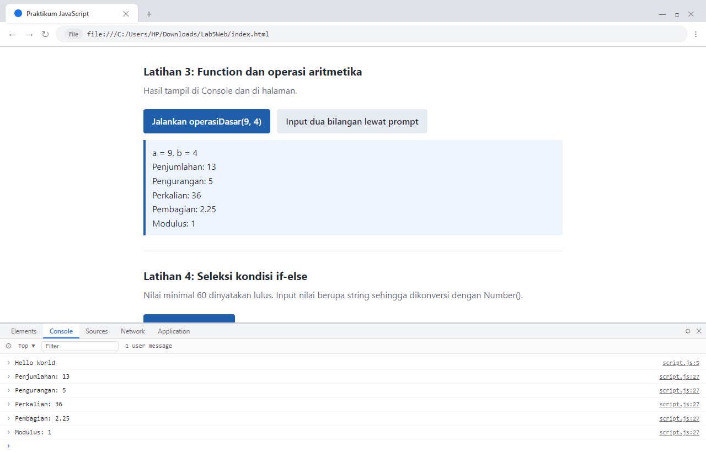

---

### Latihan 4: Seleksi Kondisi if–else
- **Penjelasan:** Meminta masukan nilai prestasi belajar (0–100) melalui dialog `prompt()`. Karena nilai masukan berupa string, dilakukan konversi eksplisit menggunakan `Number()`. Program memvalidasi masukan secara ketat: jika dibatalkan (`null`), kosong, bukan representasi angka (`Number.isNaN()`), atau di luar rentang `< 0` maupun `> 100`, akan dimunculkan pesan kesalahan `"Input nilai tidak valid."`. Bila valid, nilai `>= 60` dinyatakan `"Lulus"`, dan selebihnya `"Belum lulus"`.
- **Kode Program:**
  ```javascript
  function latihan4() {
    const inputNilai = prompt("Masukkan nilai (0-100):");
    const nilaiMahasiswa = Number(inputNilai);
    if (inputNilai === null || inputNilai.trim() === "" ||
        Number.isNaN(nilaiMahasiswa) || nilaiMahasiswa < 0 || nilaiMahasiswa > 100) {
      alert("Input nilai tidak valid.");
    } else if (nilaiMahasiswa >= 60) {
      alert("Lulus");
    } else {
      alert("Belum lulus");
    }
  }
  ```
- **Tabel Hasil Pengujian:**
  | Masukan Pengguna | Konversi Nilai | Evaluasi Kondisi | Pesan Alert Diharapkan | Hasil Nyata | Status |
  | :--- | :--- | :--- | :--- | :--- | :--- |
  | `"75"` | `75` | `75 >= 60` | `"Lulus"` | Alert: `"Lulus"` | **LULUS** |
  | `"40"` | `40` | `40 < 60` | `"Belum lulus"` | Alert: `"Belum lulus"` | **LULUS** |
  | `"abc"` | `NaN` | `Number.isNaN(NaN)` | `"Input nilai tidak valid."` | Alert: `"Input nilai tidak valid."` | **LULUS** |
  | `"-5"` | `-5` | `-5 < 0` | `"Input nilai tidak valid."` | Alert: `"Input nilai tidak valid."` | **LULUS** |
  | `"105"` | `105` | `105 > 100` | `"Input nilai tidak valid."` | Alert: `"Input nilai tidak valid."` | **LULUS** |

> **Catatan Pengambilan Screenshot Dialog Native:**  
> - *[Screenshot akan ditambahkan manual: `04a_latihan4_prompt.png` - Dialog input nilai]*
> - *[Screenshot akan ditambahkan manual: `04b_latihan4_lulus.png` - Alert "Lulus" pada input 75]*
> - *[Screenshot akan ditambahkan manual: `04c_latihan4_belum_lulus.png` - Alert "Belum lulus" pada input 40]*
> - *[Screenshot akan ditambahkan manual: `04d_latihan4_tidak_valid.png` - Alert "Input nilai tidak valid."]*

---

### Latihan 5: Seleksi Kondisi switch
- **Penjelasan:** Meminta pengguna memasukkan karakter digit 1 sampai 5. Struktur kendali `switch` memeriksa kecocokan nilai pembanding bertipe string dengan pernyataan `case`. Pernyataan `break` menghentikan evaluasi blok agar eksekusi tidak berlanjut ke percabangan berikutnya (*fall-through*), dan blok `default` menangani masukan apa pun selain angka 1–5.
- **Kode Program:**
  ```javascript
  function latihan5() {
    const inputPilihan = prompt("Masukkan angka 1-5:");
    switch (inputPilihan) {
      case "1": alert("Bilangan satu"); break;
      case "2": alert("Bilangan dua"); break;
      case "3": alert("Bilangan tiga"); break;
      case "4": alert("Bilangan empat"); break;
      case "5": alert("Bilangan lima"); break;
      default: alert("Pilihan tidak tersedia");
    }
  }
  ```
- **Tabel Hasil Pengujian:**
  | Masukan Input | Percabangan Case yang Terpilih | Pesan Alert Diharapkan | Hasil Nyata | Status |
  | :--- | :--- | :--- | :--- | :--- |
  | `"3"` | `case "3":` | `"Bilangan tiga"` | Alert: `"Bilangan tiga"` | **LULUS** |
  | `"9"` | `default:` | `"Pilihan tidak tersedia"` | Alert: `"Pilihan tidak tersedia"` | **LULUS** |
  | `"x"` | `default:` | `"Pilihan tidak tersedia"` | Alert: `"Pilihan tidak tersedia"` | **LULUS** |

> **Catatan Pengambilan Screenshot Dialog Native:**  
> - *[Screenshot akan ditambahkan manual: `05a_latihan5_prompt.png` - Dialog prompt input angka 1-5]*
> - *[Screenshot akan ditambahkan manual: `05b_latihan5_hasil.png` - Alert hasil "Bilangan tiga"]*

---

### Latihan 6: Formulir Penentu Bilangan Genap atau Ganjil
- **Penjelasan:** Mengambil nilai masukan dari elemen input formulir `<input type="number" id="bilangan" step="1">`. Nilai dibaca melalui atribut `.value` kemudian divalidasi. Method `Number.isInteger(angka)` memastikan bahwa nilai merupakan bilangan bulat (bukan desimal atau karakter kosong). Jika valid, operator sisa bagi (`angka % 2 === 0`) digunakan untuk mengelompokkan bilangan genap atau ganjil.
- **Kode Program:**
  ```javascript
  function cekBilangan() {
    const input = document.getElementById("bilangan").value;
    const angka = Number(input);
    const hasil = document.getElementById("hasilBilangan");
    if (input.trim() === "" || !Number.isInteger(angka)) {
      hasil.textContent = "Masukkan bilangan bulat yang valid.";
    } else if (angka % 2 === 0) {
      hasil.textContent = "Bilangan genap";
    } else {
      hasil.textContent = "Bilangan ganjil";
    }
  }
  ```
- **Tabel Hasil Pengujian:**
  | Nilai Masukan | Karakteristik Masukan | Hasil Diharapkan | Hasil Nyata di Browser | Status |
  | :--- | :--- | :--- | :--- | :--- |
  | `8` | Bilangan bulat positif genap | `"Bilangan genap"` | `"Bilangan genap"` | **LULUS** |
  | `7` | Bilangan bulat positif ganjil | `"Bilangan ganjil"` | `"Bilangan ganjil"` | **LULUS** |
  | `-3` | Bilangan bulat negatif ganjil | `"Bilangan ganjil"` | `"Bilangan ganjil"` | **LULUS** |
  | `0` | Bilangan nol (genap) | `"Bilangan genap"` | `"Bilangan genap"` | **LULUS** |
  | `2.5` | Bilangan pecahan/desimal | `"Masukkan bilangan bulat yang valid."` | `"Masukkan bilangan bulat yang valid."` | **LULUS** |
  | *(kosong)* | Nilai string kosong | `"Masukkan bilangan bulat yang valid."` | `"Masukkan bilangan bulat yang valid."` | **LULUS** |

- **Tangkapan Layar:**
  - *Uji Bilangan Genap (8):*  
    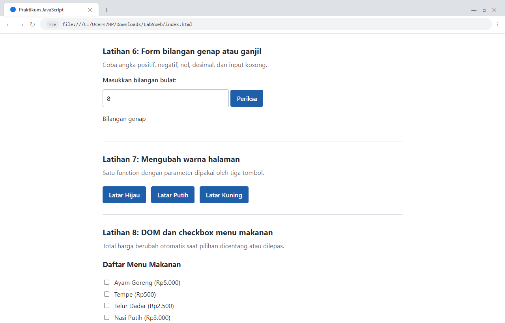
  - *Uji Bilangan Ganjil (7):*  
    
  - *Uji Masukan Tidak Valid (2.5 / Kosong):*  
    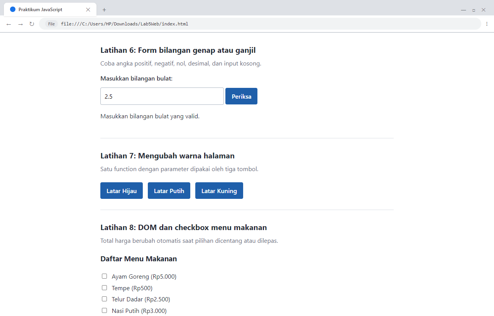

---

### Latihan 7: Mengubah Warna Latar Halaman
- **Penjelasan:** Mengimplementasikan fungsi modular `ubahWarnaLatar(warna)` yang menerima parameter kode warna CSS, kemudian memanipulasi properti CSS DOM `document.body.style.backgroundColor`. Fungsi ini digunakan secara bersama oleh tiga tombol HTML (`lightgreen`, `white`, dan `lightyellow`) sehingga kode tetap bersih tanpa duplikasi.
- **Kode Program:**
  ```javascript
  function ubahWarnaLatar(warna) {
    document.body.style.backgroundColor = warna;
  }
  ```
- **Tabel Hasil Pengujian:**
  | Tombol Diklik | Parameter Warna | Gaya CSS `backgroundColor` Terpasang | Hasil Nyata | Status |
  | :--- | :--- | :--- | :--- | :--- |
  | Latar Hijau | `'lightgreen'` | `rgb(144, 238, 144)` | Latar body hijau muda | **LULUS** |
  | Latar Putih | `'white'` | `rgb(255, 255, 255)` | Latar body putih bersih | **LULUS** |
  | Latar Kuning | `'lightyellow'` | `rgb(255, 255, 224)` | Latar body kuning muda | **LULUS** |

- **Tangkapan Layar:**
  - *Latar Hijau Muda:*  
    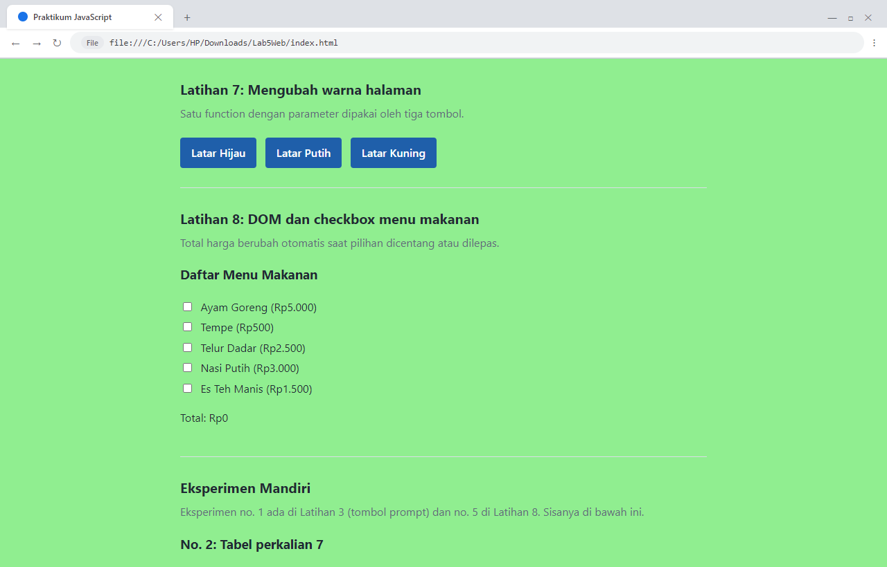
  - *Latar Kuning Muda:*  
    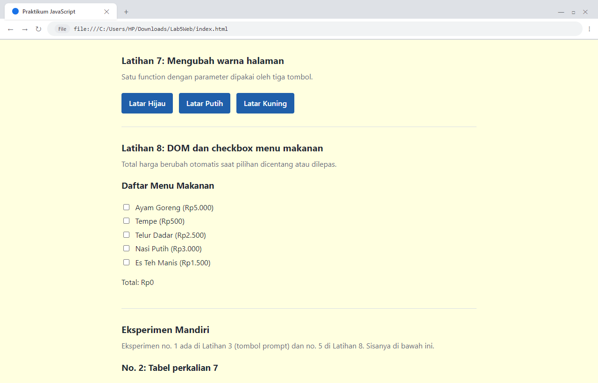

---

### Latihan 8: DOM dan Checkbox Menu Makanan
- **Penjelasan:** Memilih seluruh elemen checkbox berkategori menu menggunakan `document.querySelectorAll(".menu")` dan memasang event listener `change` pada tiap elemen. Setiap kali status centang berubah, fungsi `hitungTotal()` mengulang iterasi untuk menjumlahkan `value` checkbox yang aktif (`item.checked === true`) lalu memformat total rupiah secara otomatis dengan `.toLocaleString("id-ID")`. Menu telah ditambah 2 pilihan sesuai Eksperimen Mandiri No. 5.
- **Kode Program:**
  ```javascript
  const daftarMenu = document.querySelectorAll(".menu");
  daftarMenu.forEach((item) => {
    item.addEventListener("change", hitungTotal);
  });

  function hitungTotal() {
    let total = 0;
    daftarMenu.forEach((item) => {
      if (item.checked) total += Number(item.value);
    });
    document.getElementById("total").textContent = total.toLocaleString("id-ID");
  }
  ```
- **Tabel Hasil Pengujian:**
  | Pilihan Menu Dicentang | Perhitungan Nilai (Rp) | Nilai Total Diharapkan | Hasil Teks `#total` | Status |
  | :--- | :--- | :--- | :--- | :--- |
  | *(Tidak ada yang dipilih)* | 0 | `0` | `"0"` | **LULUS** |
  | Ayam Goreng (5.000) + Telur Dadar (2.500) + Es Teh Manis (1.500) | 5.000 + 2.500 + 1.500 | `9.000` | `"9.000"` | **LULUS** |

- **Tangkapan Layar:**
  - *Kondisi Belum Dipilih (Total 0):*  
    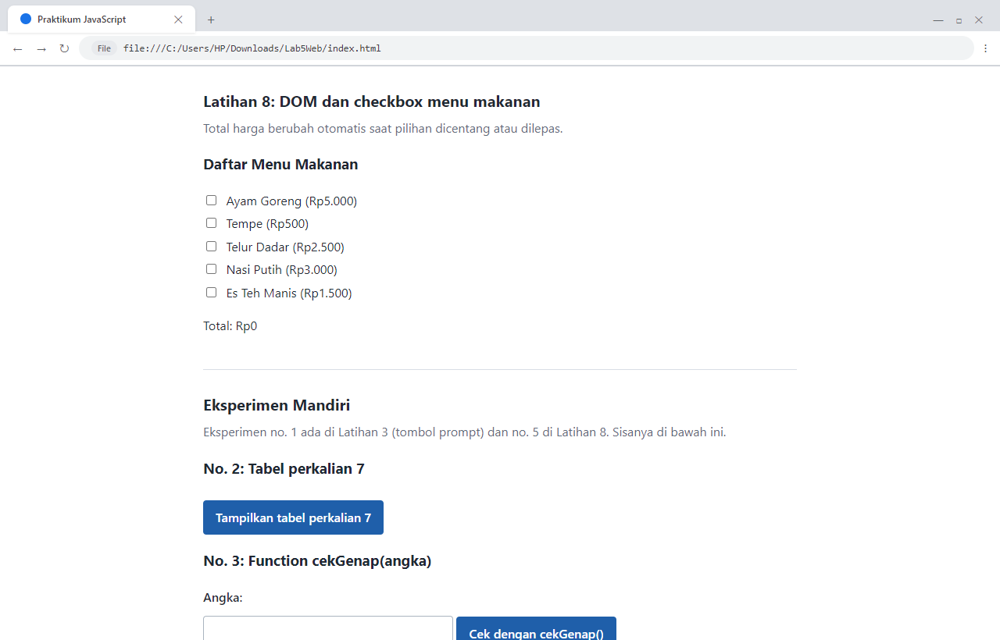
  - *Kondisi Terpilih Rp9.000:*  
    

---

## Eksperimen Mandiri (Bagian G Modul)

| No. | Rincian Eksperimen | Implementasi dan Lokasi Kode | Hasil Pengujian |
| :---: | :--- | :--- | :--- |
| **1** | Menerima dua nilai dari `prompt` dan mengonversinya menjadi number pada Latihan 3 | Tombol "Input dua bilangan lewat prompt" (`latihan3Prompt()`) di Bagian Latihan 3 | Input dikonversi dengan `Number()` dan divalidasi `!isNaN()` sebelum dikirim ke `operasiDasar()` |
| **2** | Perulangan `for` untuk menampilkan tabel perkalian 7 dari 1 sampai 10 | Tombol "Tampilkan tabel perkalian 7" (`tabelPerkalian(7)`) di Bagian Eksperimen | Menghasilkan tabel HTML rapi 10 baris (`7 x 1 = 7` hingga `7 x 10 = 70`) dan tercatat di Console |
| **3** | Function `cekGenap(angka)` yang mengembalikan nilai boolean `true` jika angka genap | Form uji `cekGenap(angka)` dengan tombol uji (`uji_cekGenap()`) di Bagian Eksperimen | Menguji angka masukan (contoh: 14) dan mengembalikan pesan `"cekGenap(14) mengembalikan true"` |
| **4** | Validasi formulir agar kolom tidak boleh dibiarkan kosong | Form kota asal (`validasiKosong()`) di Bagian Eksperimen | Menolak input kosong dengan pesan `"Kolom kota asal tidak boleh kosong."`, dan menerima input jika terisi |
| **5** | Menambah minimal dua menu makanan beserta harga pada Latihan 8 | Ditambahkan menu Nasi Putih (Rp3.000) dan Es Teh Manis (Rp1.500) pada formulir Latihan 8 | Total harga otomatis mengkalkulasi menu tambahan secara presisi |
| **6** | Tombol untuk menyembunyikan atau menampilkan elemen HTML | Tombol toggle (`toggleElemen()`) menggunakan manipulasi `style.display` | Mengubah status tampilan paragraf antara `none` dan `block` secara bergantian |

- **Tangkapan Layar Eksperimen Mandiri:**
  - *No. 2: Tabel Perkalian 7:*  
    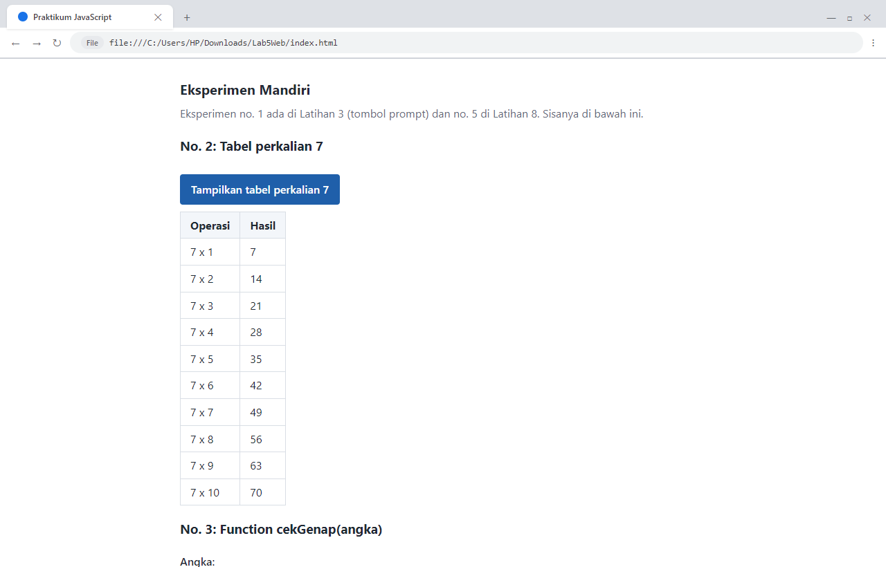
  - *No. 3: Uji `cekGenap(angka)`:*  
    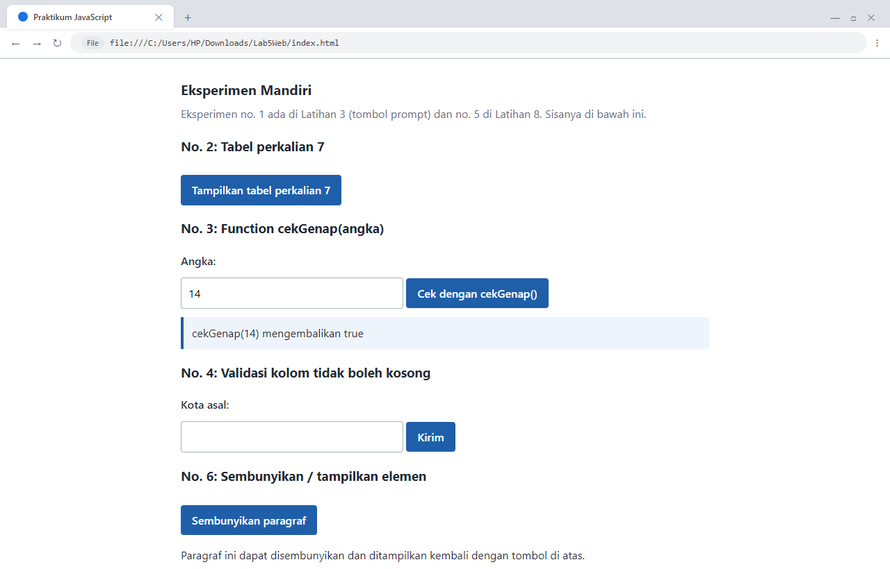
  - *No. 4: Validasi Kolom Kosong:*  
    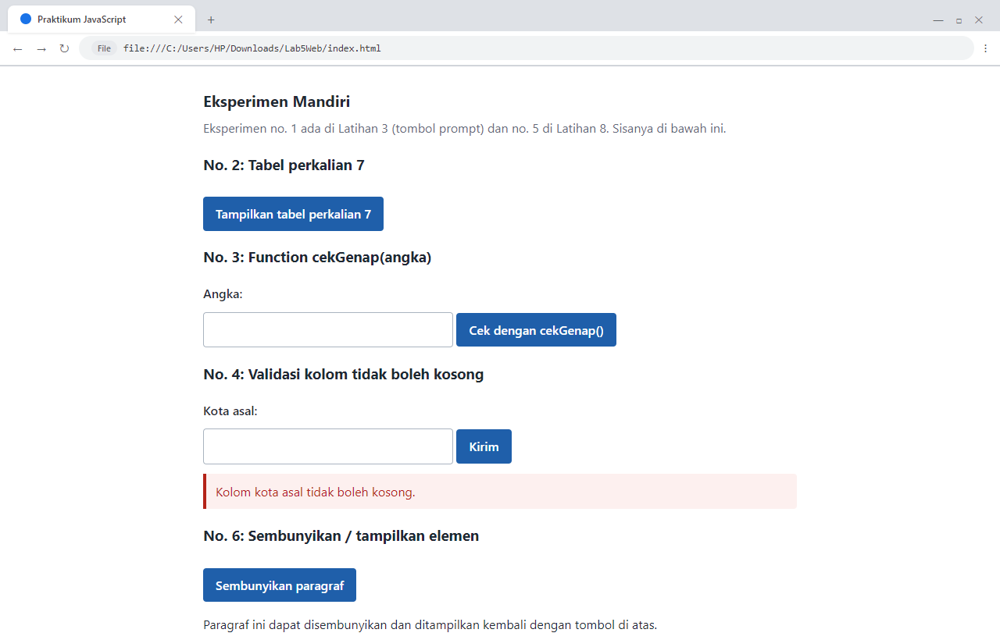
  - *No. 6: Toggle Sembunyikan/Tampilkan Paragraf:*  
    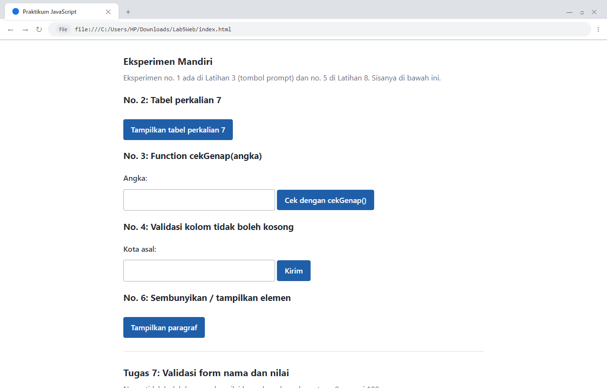

---

## Tugas 7 (Bagian H Modul): Validasi Form Nama dan Nilai

- **Penjelasan:** Memvalidasi form input nama dan nilai siswa. Program memeriksa dua kriteria: (1) nama tidak boleh kosong setelah di-trim, dan (2) nilai harus berupa bilangan valid pada rentang 0 hingga 100. Seluruh pesan kesalahan ditampung dalam sebuah larik (`pesanError = []`) dan ditampilkan sekaligus kepada pengguna jika ada kesalahan. Bila semua input valid, pesan konfirmasi sukses ditampilkan.
- **Kode Program:**
  ```javascript
  function validasiForm() {
    const nama = document.getElementById("namaTugas").value.trim();
    const inputNilai = document.getElementById("nilaiTugas").value.trim();
    const nilai = Number(inputNilai);
    const kotak = document.getElementById("hasilTugas");
    const pesanError = [];

    if (nama === "") {
      pesanError.push("Nama tidak boleh kosong.");
    }
    if (inputNilai === "" || Number.isNaN(nilai)) {
      pesanError.push("Nilai harus diisi dengan angka.");
    } else if (nilai < 0 || nilai > 100) {
      pesanError.push("Nilai harus berada pada rentang 0 sampai 100.");
    }

    if (pesanError.length > 0) {
      kotak.className = "hasil salah";
      kotak.textContent = pesanError.join("\n");
    } else {
      kotak.className = "hasil benar";
      kotak.textContent = "Data valid. Nama: " + nama + ", nilai: " + nilai + ".";
    }
  }
  ```
- **Tabel Hasil Pengujian:**
  | Skenario Uji | Input Nama | Input Nilai | Pesan Validasi Diharapkan | Hasil Tampilan Nyata | Status |
  | :--- | :--- | :--- | :--- | :--- | :--- |
  | **Uji Kesalahan** | `""` *(kosong)* | `150` *(out of range)* | "Nama tidak boleh kosong.<br>Nilai harus berada pada rentang 0 sampai 100." | Dua pesan error muncul sekaligus dalam kotak merah | **LULUS** |
  | **Uji Keberhasilan** | `"Kartika Juliana Sasongko"` | `90` | "Data valid. Nama: Kartika Juliana Sasongko, nilai: 90." | Kotak hijau sukses menampilkan data | **LULUS** |

- **Tangkapan Layar:**
  - *Validasi Gagal (Semua Pesan Error Terkumpul):*  
    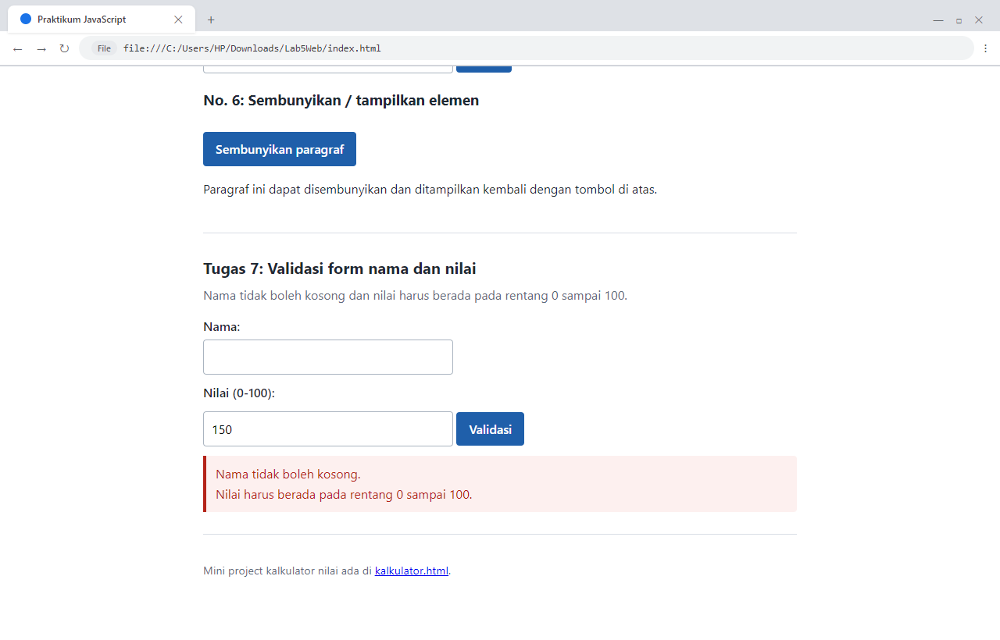
  - *Validasi Berhasil:*  
    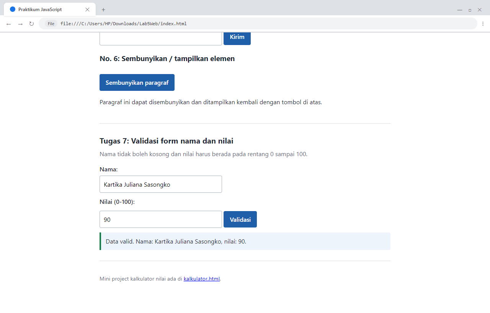

---

## Mini Project: Kalkulator Nilai Mahasiswa

Mini project dirancang secara modular pada berkas `kalkulator.html` dan `kalkulator.js` dengan memisahkan tiga tanggung jawab utama:
1. **Logika Perhitungan (*Pure Functions*):** Fungsi `hitungNilaiAkhir()`, `tentukanPredikat()`, dan `tentukanStatus()` tidak menyentuh elemen HTML sehingga mudah diuji (*unit testing*).
2. **Validasi Masukan:** Fungsi `bacaNilai()` memeriksa apakah masukan berupa angka dan berada dalam batas 0 sampai 100. Setiap kolom yang tidak valid akan memunculkan pesan spesifik.
3. **Pengendali Tampilan (*UI Controller*):** Fungsi `tampilkanHasil()` mengelola pembacaan form, pencetakan hasil ke Console, dan manipulasi elemen visual `#hasilKalkulator`.

### Rumus dan Skema Evaluasi
- **Rumus Nilai Akhir:** $\text{Nilai Akhir} = (\text{Tugas} \times 30\%) + (\text{UTS} \times 30\%) + (\text{UAS} \times 40\%)$
- **Tabel Predikat:**
  - $\ge 85$: **A**
  - $\ge 75$: **B**
  - $\ge 60$: **C**
  - $\ge 50$: **D**
  - $< 50$: **E**
- **Status Kelulusan:** Nilai Akhir $\ge 60$ dinyatakan **Lulus**, selain itu **Belum lulus**.

### Kode Program Utama (`kalkulator.js`):
```javascript
function hitungNilaiAkhir(tugas, uts, uas) {
  return tugas * 0.30 + uts * 0.30 + uas * 0.40;
}

function tentukanPredikat(nilai) {
  if (nilai >= 85) return "A";
  if (nilai >= 75) return "B";
  if (nilai >= 60) return "C";
  if (nilai >= 50) return "D";
  return "E";
}

function tentukanStatus(nilai) {
  return nilai >= 60 ? "Lulus" : "Belum lulus";
}
```

### Tabel Hasil Pengujian 3 Skenario Wajib + Validasi Form Kosong:
| Skenario | Nilai Tugas | Nilai UTS | Nilai UAS | Nilai Akhir | Predikat | Status | Hasil di Console & Halaman | Status |
| :---: | :---: | :---: | :---: | :---: | :---: | :---: | :--- | :---: |
| **Validasi Kosong** | `""` | `""` | `""` | - | - | - | 3 pesan error validasi input kolom | **LULUS** |
| **Skenario 1** | 85 | 78 | 88 | **84.10** | **B** | **Lulus** | Nilai: 84.10, Predikat: B, Status: Lulus | **LULUS** |
| **Skenario 2** | 60 | 55 | 62 | **59.30** | **D** | **Belum lulus** | Nilai: 59.30, Predikat: D, Status: Belum lulus | **LULUS** |
| **Skenario 3** | 40 | 30 | 45 | **39.00** | **E** | **Belum lulus** | Nilai: 39.00, Predikat: E, Status: Belum lulus | **LULUS** |

- **Tangkapan Layar Mini Project:**
  - *Validasi Form Kosong:*  
    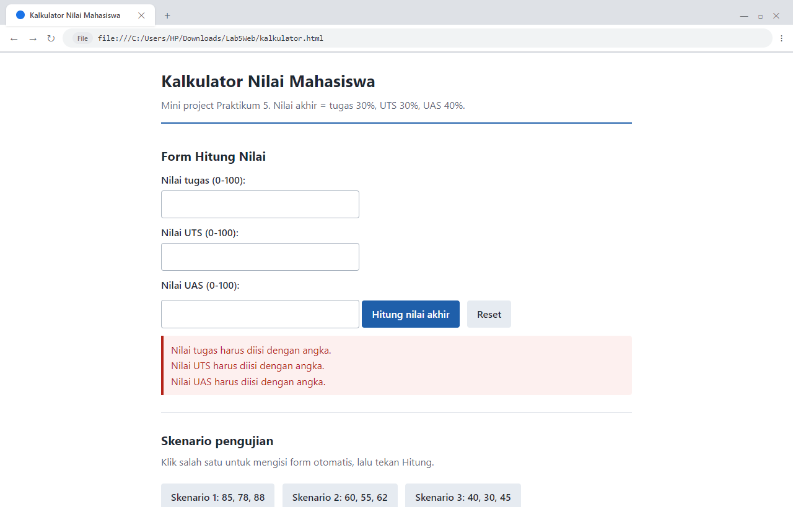
  - *Skenario 1 (85, 78, 88) [CONSOLE]:*  
    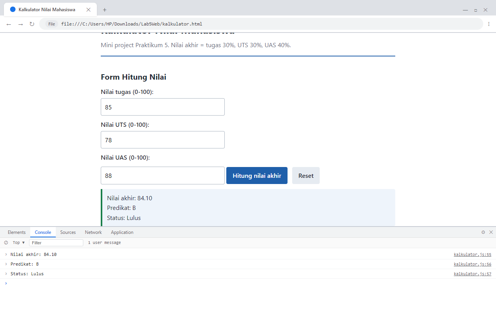
  - *Skenario 2 (60, 55, 62) [CONSOLE]:*  
    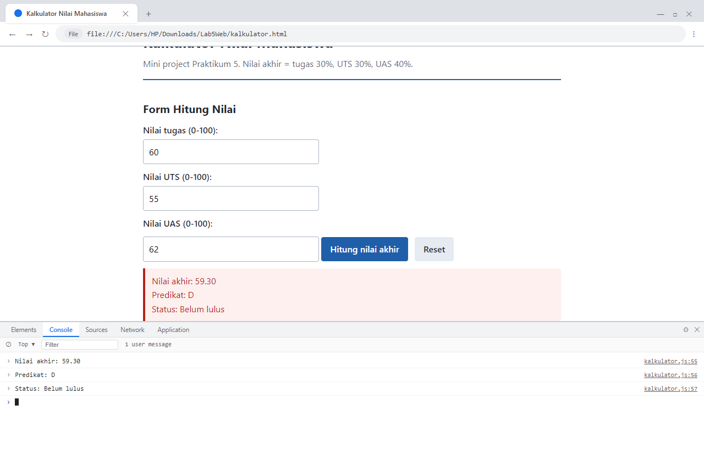
  - *Skenario 3 (40, 30, 45) [CONSOLE]:*  
    

---

## Pertanyaan dan Tugas (Bagian H Modul)

### 1. Jelaskan perbedaan `console.log()`, `alert()`, `prompt()`, dan `textContent`/`innerHTML`!
- **`console.log()`**: Menuliskan pesan atau representasi objek ke *Web Console Developer Tools*. Instruksi ini tidak terlihat oleh pengunjung biasa dan tidak memblokir alur eksekusi kode, sehingga sangat ideal untuk debugging internal programmer.
- **`alert()`**: Menampilkan kotak dialog modal sederhana berisikan pesan teks dan tombol "OK". Selama kotak alert belum ditutup oleh pengguna, eksekusi kode JavaScript pada halaman akan terhenti sementara (*blocking thread*).
- **`prompt()`**: Menampilkan kotak dialog modal input teks yang meminta respons dari pengguna. Fungsi ini mengembalikan nilai berupa `string` jika tombol "OK" diklik, atau mengembalikan `null` jika pengguna menekan tombol "Cancel".
- **`textContent`**: Properti DOM yang digunakan untuk membaca atau mengubah teks murni dari suatu elemen HTML. Semua karakter khusus dianggap sebagai teks biasa dan tidak akan dievaluasi sebagai kode HTML, sehingga aman dari risiko celah keamanan Cross-Site Scripting (XSS).
- **`innerHTML`**: Properti DOM yang membaca atau mengganti konten elemen beserta tag-tag HTML di dalamnya. String yang dimasukkan akan di-parse oleh peramban menjadi node DOM baru.

---

### 2. Apa perbedaan `let` dan `const`? Berikan contohnya!
- **`let`**: Digunakan untuk mendeklarasikan variabel yang nilainya dapat diubah atau di-reassign di kemudian hari. `let` memiliki cakupan blok (*block scope*).
- **`const`**: Digunakan untuk mendeklarasikan identifier konstanta yang nilainya **tidak dapat di-reassign** setelah diinisialisasi pertama kali. `const` juga memiliki *block scope*. Namun, untuk objek atau array bertipe `const`, properti atau elemen di dalamnya tetap dapat dimutasi.
- **Contoh Kode:**
  ```javascript
  let skor = 80;
  skor = 95; // Boleh, nilai variabel skor diperbarui

  const nama = "Kartika";
  // nama = "Juliana"; // Error: Assignment to constant variable.

  const dataMahasiswa = { nim: "312310267" };
  dataMahasiswa.kelas = "TI.25.1D"; // Boleh, memutasi properti objek
  ```

---

### 3. Apa perbedaan operator `==` dan `===`?
- **Operator `==` (*Loose Equality*):** Membandingkan kesamaan nilai setelah melakukan konversi tipe data secara otomatis (*type coercion*). Hal ini sering menyebabkan perilaku yang tidak terduga dalam logika program.
- **Operator `===` (*Strict Equality*):** Membandingkan kesamaan nilai **sekaligus tipe datanya** tanpa melakukan konversi otomatis. Hasilnya hanya bernilai `true` jika kedua operan memiliki tipe data dan nilai yang identik.
- **Contoh Kode:**
  ```javascript
  console.log(5 == "5");   // true (string "5" dikonversi otomatis menjadi angka 5)
  console.log(5 === "5");  // false (number tidak sama dengan string)
  console.log(0 == false);  // true
  console.log(0 === false); // false
  ```
  *Praktik terbaik:* Selalu gunakan operator `===` (*strict equality*) untuk menjamin keakuratan logika program.

---

### 4. Jelaskan fungsi `if–else` dan `switch`! Kapan masing-masing dapat digunakan?
- **`if–else`**: Struktur percabangan yang mengevaluasi ekspresi kondisi bernilai boolean (`true` atau `false`). Sangat tepat digunakan ketika:
  - Menguji rentang nilai (misalnya: `nilai >= 85 && nilai <= 100`).
  - Menguji kondisi logika majemuk yang melibatkan operator logika `&&`, `||`, dan `!`.
  - Kondisi melibatkan tipe data dan variabel yang berbeda-beda.
- **`switch`**: Struktur percabangan yang membandingkan suatu nilai variabel secara diskret (*strict equality*) terhadap kumpulan nilai konstanta pada blok `case`. Sangat tepat digunakan ketika:
  - Menguji satu variabel terhadap banyak kemungkinan nilai diskret atau pilihan menu tertentu (misalnya: menu "1", "2", "3", "4", "5").
  - Menghindari struktur `else if` bertingkat yang terlalu panjang sehingga kode lebih bersih dan mudah dibaca. Pernyataan `break` wajib digunakan untuk mencegah *fall-through*.

---

### 5. Apa fungsi parameter dan `return` dalam function?
- **Parameter:** Variabel penampung (*placeholder*) yang didefinisikan saat membuat fungsi untuk menerima nilai masukan (*argumen*) saat fungsi tersebut dipanggil. Parameter membuat sebuah fungsi bersifat dinamis dan dapat digunakan berulang kali (*reusable*) dengan berbagai macam data masukan.
- **Return:** Pernyataan yang digunakan untuk mengembalikan nilai hasil pemrosesan dari dalam fungsi kembali ke baris kode yang memanggilnya, sekaligus menghentikan eksekusi fungsi tersebut secara tuntas.
- **Contoh Kode:**
  ```javascript
  // panjang dan lebar adalah parameter
  function hitungLuasPersegi(panjang, lebar) {
    const luas = panjang * lebar;
    return luas; // Mengembalikan hasil perhitungan
  }

  const hasil1 = hitungLuasPersegi(10, 5); // hasil1 bernilai 50
  const hasil2 = hitungLuasPersegi(8, 4);  // hasil2 bernilai 32
  ```

---

### 6. Bagaimana JavaScript memilih elemen HTML menggunakan `document.getElementById()`?
- Method `document.getElementById(idString)` melakukan penelusuran terhadap pohon DOM (*Document Object Model*) untuk mencari elemen pertama yang atribut `id`-nya tepat sama dengan nilai string yang dioperasikan.
- Jika elemen ditemukan, peramban mengembalikan objek representasi elemen tersebut (misalnya `HTMLParagraphElement` atau `HTMLInputElement`), yang kemudian dapat dibaca maupun dimodifikasi propertinya (seperti `.textContent`, `.value`, `.style`).
- Jika tidak ada elemen yang memiliki ID tersebut pada dokumen, method ini mengembalikan nilai `null`.

---

### 7. Buat script untuk memvalidasi form agar nama tidak kosong dan nilai berada pada rentang 0–100!
- **Implementasi Script:**
  ```javascript
  function validasiFormMahasiswa() {
    const elemenNama = document.getElementById("namaTugas");
    const elemenNilai = document.getElementById("nilaiTugas");
    const kotakHasil = document.getElementById("hasilTugas");

    const nama = elemenNama.value.trim();
    const inputNilai = elemenNilai.value.trim();
    const nilai = Number(inputNilai);
    const pesanError = [];

    // Validasi 1: Nama tidak boleh kosong
    if (nama === "") {
      pesanError.push("Nama tidak boleh kosong.");
    }

    // Validasi 2: Nilai harus numerik dan berada di rentang 0 - 100
    if (inputNilai === "" || Number.isNaN(nilai)) {
      pesanError.push("Nilai harus diisi dengan angka.");
    } else if (nilai < 0 || nilai > 100) {
      pesanError.push("Nilai harus berada pada rentang 0 sampai 100.");
    }

    // Tampilkan hasil secara akumulatif
    if (pesanError.length > 0) {
      kotakHasil.className = "hasil salah";
      kotakHasil.textContent = pesanError.join("\n");
    } else {
      kotakHasil.className = "hasil benar";
      kotakHasil.textContent = "Data valid. Nama: " + nama + ", nilai: " + nilai + ".";
    }
  }
  ```

---

## Catatan Validasi Kode (W3C Nu HTML Checker)

Seluruh berkas HTML telah divalidasi menggunakan standar internasional resmi [W3C Nu HTML Checker](https://validator.w3.org/nu/):
- **`index.html`**: **0 Errors, 0 Warnings** (100% Valid HTML5 Standard Compliant).
- **`kalkulator.html`**: **0 Errors, 0 Warnings** (100% Valid HTML5 Standard Compliant, seluruh section dilengkapi penanda semantik `<h2>`).

---

## Kesimpulan

Berdasarkan seluruh rangkaian pengerjaan dan pengujian Praktikum 5, dapat disimpulkan bahwa:
1. JavaScript merupakan bahasa pemrograman esensial pada sisi klien (*client-side*) yang memungkinkan dokumen web statis berubah menjadi interaktif dan dinamis melalui pemanfaatan Document Object Model (DOM).
2. Penggunaan struktur logika seperti percabangan (`if-else` dan `switch`) serta perulangan (`for`) memungkinkan aplikasi web mengambil keputusan dan mengolah data secara terstruktur sesuai kriteria yang ditentukan.
3. Penerapan arsitektur kode yang memisahkan antara fungsi logika perhitungan murni (*business logic*) dan fungsi manipulasi antarmuka (*UI controller*)—seperti yang diimplementasikan pada mini project kalkulator—menjadikan kode program lebih bersih, mudah dibaca, serta dapat diuji (*testable*) dengan tingkat keandalan yang tinggi.
4. Validasi masukan pengguna pada formulir merupakan langkah krusial untuk mencegah inkonsistensi data, di mana data dari pengguna selalu berwujud string sehingga wajib dipangkas (*trim*), divalidasi representasi bilangannya, dan dipastikan berada dalam batas rentang nilai yang diizinkan sebelum diproses lebih lanjut.
